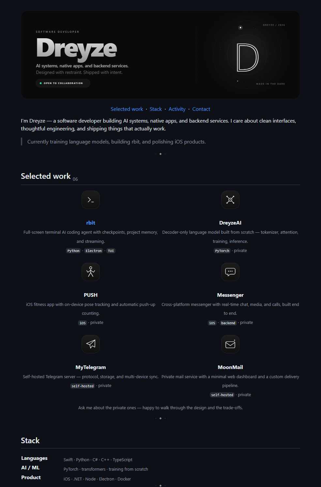

<div align="center">
  
</div>

<p align="center">
  <sub>MIT · Node 20+ · zero dependencies · dark by design</sub>
</p>

<p align="center">
  <a href="#preview">Preview</a> &nbsp;·&nbsp;
  <a href="#quick-start">Quick start</a> &nbsp;·&nbsp;
  <a href="#config">Config</a> &nbsp;·&nbsp;
  <a href="#live-stats">Live stats</a> &nbsp;·&nbsp;
  <a href="examples/dreyze/README.md">Full demo</a>
</p>

**Noir** is a monochrome design kit for GitHub profiles and repository READMEs. One JSON file generates an animated SVG hero, a curated project grid, a live metrics card, and a matching repository aesthetic. No shields.io, no capsule-render, no image services — every asset is self-contained and yours.

## Preview

<a href="examples/dreyze/README.md">
  
</a>

<p align="center">
  <sub>The included demo, generated from <a href="profile.config.json">profile.config.json</a>. <a href="examples/dreyze/README.md">Open the full README →</a></sub>
</p>

## What you get

- **Animated hero** — orbit rings, a light sweep and a monogram built from your initial. Pure SVG and CSS, respects `prefers-reduced-motion`.
- **Project grid** — a two-column layout with a built-in stroke icon set. Links for public work, quiet notes for private work.
- **Live metrics** — public repos, followers, events and a 13-week activity grid, refreshed daily by GitHub Actions.
- **One config** — every word, link, tag and icon comes from `profile.config.json`.
- **Theme-safe** — self-contained dark cards look intentional on both GitHub light and dark themes.
- **No services** — nothing to sign up for, nothing to track you, no broken third-party badges.

## Quick start

```bash
git clone https://github.com/DreyzeDev/noir.git my-profile
cd my-profile
```

Edit `profile.config.json`, then generate:

```bash
npm run build          # → dist/
```

Copy `dist/README.md` and `dist/assets/` into your profile repository — or render straight into it:

```bash
node scripts/build.mjs profile.config.json ../my-profile
```

> For a profile README, the target repository must be named exactly like your GitHub username. The same output also works as a repository header: drop the hero at the top of any README.

## Config

| Field | Type | Notes |
| --- | --- | --- |
| `name` | string | Wordmark and monogram initial. Required. |
| `role` | string | Small overline in the hero. |
| `tagline` | string[] | Up to two lines under the wordmark. |
| `badge` | string / object | Status pill. `{ "text": "...", "color": "#34d399", "dot": true }`. |
| `meta` | object | Micro labels: `{ "top": "...", "bottom": "..." }`. |
| `bio` | string | Paragraph under the hero. |
| `now` | string | Rendered as a quote. |
| `github` | string | Login used for profile links and, by default, stats. |
| `telegram` | string | Telegram handle for the contact row. |
| `email` | string | Adds an email link. |
| `website` | string | Adds a website link. |
| `links` | `{ label, url }[]` | Extra contact links. |
| `stats.username` | string | GitHub login for the live card. |
| `projects` | object[] | `name`, `description`, `icon`, `url`, `tags[]`, `note`. |
| `projectsNote` | string | Small line under the project grid. |
| `stack` | `{ label, items[] }[]` | Stack rows. |
| `footerNote` | string | Small line above the footer. |
| `copyright` | string | Footer line. |
| `credit` | `{ label, url }` | Optional "Built with" credit. |
| `labels` | object | Override section titles: `work`, `stack`, `activity`, `contact`. |

Available project icons:

`terminal` `neural` `activity` `chat` `send` `mail` `code` `layers` `cube` `bolt` `globe` `lock` `spark`

Minimal config:

```json
{
  "name": "Ada",
  "role": "Systems engineer",
  "tagline": ["Low-level software, high-level polish."],
  "badge": "Open to collaboration",
  "github": "ada",
  "stats": { "username": "ada" },
  "projects": [
    {
      "name": "engine",
      "description": "A tiny WebAssembly runtime written from scratch.",
      "icon": "cube",
      "url": "https://github.com/ada/engine",
      "tags": ["Rust", "WASM"]
    }
  ],
  "stack": [
    { "label": "Languages", "items": ["Rust", "C", "TypeScript"] }
  ]
}
```

## Live stats

The metrics card reads public GitHub data: repositories, followers, public events and active days over the last 90 days, plus the weekly grid.

The included workflow refreshes the demo daily:

```yaml
on:
  schedule:
    - cron: "23 5 * * *"
```

Copy `.github/workflows/stats.yml` into your repository, point the `run` step at your output folder, and the built-in `GITHUB_TOKEN` does the rest. No PAT, no secrets. Only public activity is counted.

If the workflow cannot push, allow write access under **Settings → Actions → General → Workflow permissions**.

Manual refresh:

```bash
node scripts/build.mjs profile.config.json dist
node scripts/update-stats.mjs profile.config.json dist
```

## Files

```
profile.config.json        your content
scripts/build.mjs          generates README + assets
scripts/update-stats.mjs   refreshes the metrics card only
scripts/lib/hero.mjs       animated 1200×380 hero
scripts/lib/readme.mjs     profile README generator
scripts/lib/stats.mjs      live metrics card
scripts/lib/icons.mjs      built-in stroke icon set
examples/dreyze/           generated demo
docs/assets/               preview images
```

Colors, type and motion live inside `scripts/lib`. Plain Node 20+, no dependencies, no bundler.

## Notes

- The hero is a dark card, so it blends into dark themes and stands out on light ones.
- Motion is CSS-only inside the SVG and disabled under `prefers-reduced-motion`.
- The hero fades in on load; the first frame is intentionally empty.
- Most repositories are private by nature — Noir shows public signals and leaves the rest to you.

## License

MIT. Use it, fork it, rebrand it.
