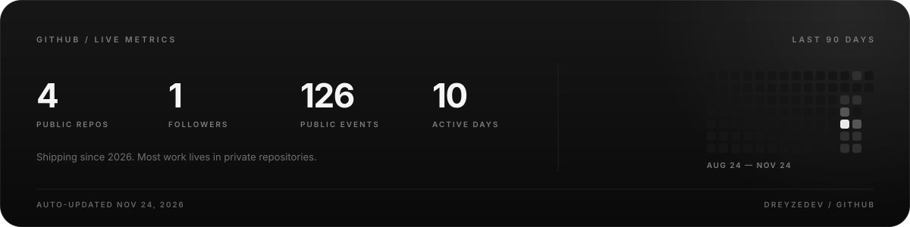

<!-- Generated by Noir — edit profile.config.json instead of this file. -->

  

  <a href="#selected-work">Selected work</a> &nbsp;·&nbsp; <a href="#stack">Stack</a> &nbsp;·&nbsp; <a href="#activity">Activity</a> &nbsp;·&nbsp; <a href="#contact">Contact</a>

I'm Dreyze — a software developer building AI systems, native apps, and backend services. I care about clean interfaces, thoughtful engineering, and shipping things that actually work.

> Currently training language models, building rbit, and polishing iOS products.

  

## Selected work 06

<table>
  <tr>
    <td width="50%" valign="top" align="center">
      
        
      <a href="https://github.com/DreyzeDev/rbit"><b>rbit</b></a> 
      Full-screen terminal AI coding agent with checkpoints, project memory, and streaming. 
      <code>Python</code> · <code>Electron</code> · <code>TUI</code>
    </td>
    <td width="50%" valign="top" align="center">
      
        
      <b>DreyzeAI</b> 
      Decoder-only language model built from scratch — tokenizer, attention, training, inference. 
      <code>PyTorch</code> · private
    </td>
  </tr>
  <tr>
    <td colspan="2" align="center"> </td>
  </tr>
  <tr>
    <td width="50%" valign="top" align="center">
      
        
      <b>PUSH</b> 
      iOS fitness app with on-device pose tracking and automatic push-up counting. 
      <code>iOS</code> · private
    </td>
    <td width="50%" valign="top" align="center">
      
        
      <b>Messenger</b> 
      Cross-platform messenger with real-time chat, media, and calls, built end to end. 
      <code>iOS</code> · <code>backend</code> · private
    </td>
  </tr>
  <tr>
    <td colspan="2" align="center"> </td>
  </tr>
  <tr>
    <td width="50%" valign="top" align="center">
      
        
      <b>MyTelegram</b> 
      Self-hosted Telegram server — protocol, storage, and multi-device sync. 
      <code>self-hosted</code> · private
    </td>
    <td width="50%" valign="top" align="center">
      
        
      <b>MoonMail</b> 
      Private mail service with a minimal web dashboard and a custom delivery pipeline. 
      <code>self-hosted</code> · private
    </td>
  </tr>
</table>

  Ask me about the private ones — happy to walk through the design and the trade-offs.

  

## Stack

<table>
  <tr>
    <td width="130" valign="top"><b>Languages</b></td>
    <td valign="top">Swift · Python · C# · C++ · TypeScript</td>
  </tr>
  <tr>
    <td width="130" valign="top"><b>AI / ML</b></td>
    <td valign="top">PyTorch · transformers · training from scratch</td>
  </tr>
  <tr>
    <td width="130" valign="top"><b>Product</b></td>
    <td valign="top">iOS · .NET · Node · Electron · Docker</td>
  </tr>
</table>

  

## Activity live

  

  

  <a href="https://github.com/DreyzeDev"><b>GitHub</b></a> &nbsp;·&nbsp; <a href="https://t.me/DreyzeDev"><b>Telegram</b></a>

  Most of my work is private — message me and I'll walk you through it.

  © 2026 Dreyze · designed and built in the dark · Built with <a href="https://github.com/DreyzeDev/noir">Noir</a>

